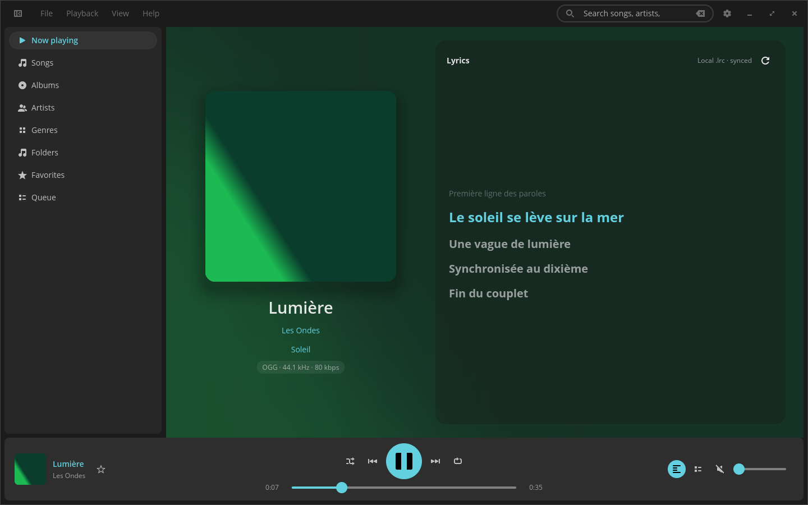
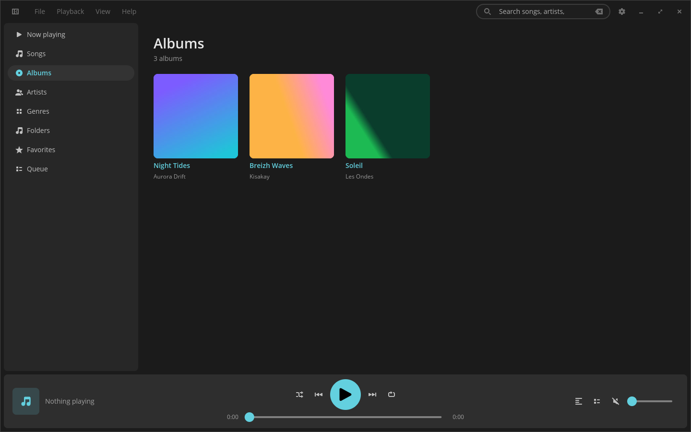
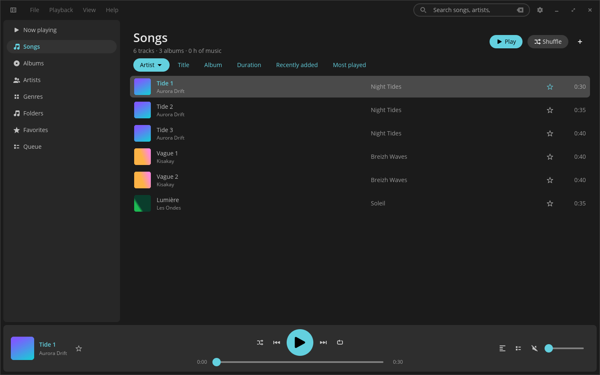
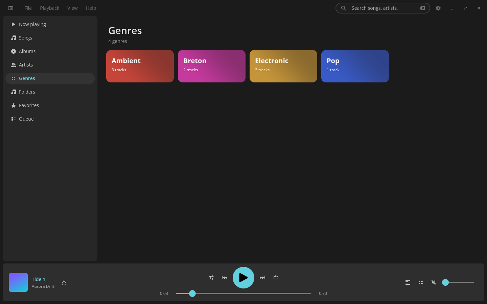

<div align="center">


# Cosmic Advanced Player

**A beautiful native music player for Linux, written in Rust with [libcosmic](https://github.com/pop-os/libcosmic).**

🌐 **[cosmic-advanced-player.v.bzh](https://cosmic-advanced-player.v.bzh)**

[](LICENSE)




</div>

---

Cosmic Advanced Player indexes your music folders, reads the cover art embedded in your files,
shows time-synced lyrics, scrobbles to Last.fm and tells Discord what you are listening to — in a
single native binary that follows your COSMIC desktop theme.

## ✨ Features

| | |
|---|---|
| **Library** | Recursive, incremental indexing of any number of folders (symbolic links followed, loops and duplicates detected), SQLite database, live re-indexing when files change |
| **Formats** | FLAC, MP3, Ogg Vorbis, Opus, AAC / M4A / ALAC, WAV, AIFF, WavPack, APE… (symphonia) |
| **Cover art** | Pictures embedded in the files (FLAC `PICTURE`, ID3 `APIC`, MP4 `covr`, Vorbis comments) or `cover.jpg` / `folder.png` next to them, cached once per image in three sizes |
| **Search** | Instant full-text search (SQLite FTS5) over titles, artists, albums, genres and paths — prefix matching, accents ignored |
| **Browsing** | Now playing, Songs (sortable), Albums grid, Artists, Genres, Folders, Favorites, Queue, album and artist pages |
| **Playback** | Gapless playback, ReplayGain normalization, shuffle, repeat all / one, perceptual volume, seek, session restore |
| **Lyrics plugins** | `.lrc` files, embedded tags, [LRCLIB](https://lrclib.net) (time-synced) and [lyrics.ovh](https://lyrics.ovh) — enable and reorder them; synced lyrics scroll karaoke-style, click a line to jump to it |
| **Last.fm** | Now playing, scrobbling with an offline queue, favorites ↔ loved tracks |
| **Discord** | Rich Presence over the local IPC socket: “Listening to”, progress bar, album cover |
| **Desktop** | MPRIS (media keys, COSMIC panel applet, `playerctl`), single instance, open files / folders from the file manager or the command line |

<table>
<tr>
<td></td>
<td></td>
</tr>
<tr>
<td></td>
<td></td>
</tr>
</table>

## 🚀 Usage

```sh
cosmic-advanced-player                    # open the library
cosmic-advanced-player ~/Music/Album      # play a folder (recursively)
cosmic-advanced-player song.flac other.mp3
```

On first launch your XDG music folder (`~/Music`) is added to the library. Add more folders in
**Settings → Library**, or use **File → Open folder…** to play a folder without indexing it.

| Shortcut | Action |
|---|---|
| <kbd>Space</kbd> | Play / pause |
| <kbd>←</kbd> / <kbd>→</kbd> | Seek 10 s |
| <kbd>Ctrl</kbd>+<kbd>←</kbd> / <kbd>→</kbd> | Previous / next track |
| <kbd>Ctrl</kbd>+<kbd>↑</kbd> / <kbd>↓</kbd> | Volume |
| <kbd>Ctrl</kbd>+<kbd>F</kbd> | Search |
| <kbd>Ctrl</kbd>+<kbd>O</kbd> | Open a folder |
| <kbd>Ctrl</kbd>+<kbd>S</kbd> / <kbd>R</kbd> | Shuffle / repeat |
| <kbd>Ctrl</kbd>+<kbd>1</kbd>…<kbd>8</kbd> | Pages |
| <kbd>Ctrl</kbd>+<kbd>,</kbd> | Settings |

### Last.fm

1. Create a free API account at <https://www.last.fm/api/account/create>.
2. Paste the **API key** and **shared secret** in **Settings → Last.fm**, click *Connect*.
3. Approve the access in your browser, then click *I have approved it*.

Scrobbles follow the Last.fm rules (tracks longer than 30 s, after half of the track or 4 minutes)
and are kept in the database until Last.fm accepts them, so nothing is lost offline.

### Discord

Discord shows the name of the *application* in “Listening to …”. Create an application named
**Cosmic Advanced Player** in the [developer portal](https://discord.com/developers/applications)
and paste its **Application ID** in **Settings → Discord**. Album covers need a public URL: they are
looked up on Last.fm (when an API key is set) or with the iTunes Search API — this can be turned off.

## 📦 Install

Every [release](https://github.com/Kisakay/CosmicAdvancedPlayer/releases) ships for **x86_64 and
aarch64**:

| Format | File |
|---|---|
| Debian / Ubuntu | `cosmic-advanced-player_<version>-1_amd64.deb` / `_arm64.deb` |
| Fedora / openSUSE | `cosmic-advanced-player-<version>-1.x86_64.rpm` / `.aarch64.rpm` |
| Any distribution | `cosmic-advanced-player-<version>-x86_64.AppImage` / `-aarch64.AppImage` |
| Tarball | `cosmic-advanced-player-<version>-linux-<arch>.tar.gz` |

Releases are immutable and come with a `SHA256SUMS` file.

### Nix / NixOS

The flake serves the **prebuilt binary of the latest GitHub release** (patched for NixOS, nothing
to compile) on `x86_64-linux` and `aarch64-linux`. Build from source with
`.#cosmic-advanced-player-source`.

```sh
nix run github:Kisakay/CosmicAdvancedPlayer
```

```nix
# flake.nix
inputs.cosmic-advanced-player.url = "github:Kisakay/CosmicAdvancedPlayer";

# NixOS configuration
imports = [ inputs.cosmic-advanced-player.nixosModules.default ];
programs.cosmic-advanced-player.enable = true;

# or Home Manager
imports = [ inputs.cosmic-advanced-player.homeManagerModules.default ];
programs.cosmic-advanced-player.enable = true;
```

An overlay (`overlays.default`) is also provided.

### From source

Requirements: Rust ≥ 1.90, `pkg-config`, and the development files of ALSA, xkbcommon, Wayland,
fontconfig and freetype (`libasound2-dev libxkbcommon-dev libwayland-dev libfontconfig1-dev
libfreetype-dev` on Debian/Ubuntu).

```sh
just build-release
sudo just install          # or: just rootdir=pkg install
```

On NixOS, `nix develop` provides everything.

## 🗂️ Where things are stored

| | |
|---|---|
| Settings | `~/.config/cosmic/io.github.kisakay.CosmicAdvancedPlayer/` |
| Library index | `~/.local/share/cosmic-advanced-player/library.db` |
| Covers & lyrics cache | `~/.cache/cosmic-advanced-player/` |

Deleting the cache is always safe; deleting the database only loses play counts and favorites.

## 🛠️ Development

```sh
nix develop        # or install the dependencies above
just run           # release build + run
just test          # unit tests
just check         # clippy -D warnings
```

The code is organised in small modules: `audio` (playback engine thread), `library`
(model, SQLite index, scanner, covers, watcher), `lyrics`, `lastfm`, `discord`, `mpris`, `queue`,
`app` (state & update) and `ui` (views).

## License

[GNU GPL v3.0](LICENSE) © Kisakay
